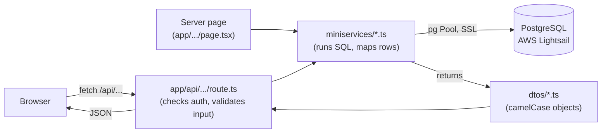
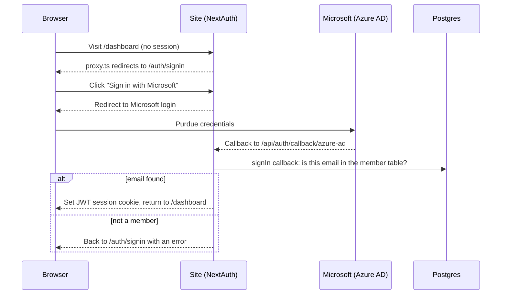

# Architecture

The site is a single [Next.js 16](https://nextjs.org/docs) App Router app written in TypeScript. It serves both the
public club website and a small signed-in area for members and officers. There is no separate backend: API routes
live in the same app and talk directly to a PostgreSQL database.

UI is built with [HeroUI v3](https://heroui.com/react) components and Tailwind CSS. Light and dark mode follow the
visitor's system setting through `next-themes`.

## Folder map

| Folder | What lives there | More detail |
| --- | --- | --- |
| `app/` | Every page (`page.tsx`) and API route (`route.ts`). The folder path is the URL. | [app/README.md](../app/README.md) |
| `app/api/` | JSON API route handlers. | [app/api/README.md](../app/api/README.md) |
| `miniservices/` | Server-only modules that run SQL against Postgres. | [miniservices/README.md](../miniservices/README.md) |
| `dtos/` | Shapes of data sent from the server to the browser. | [dtos/README.md](../dtos/README.md) |
| `models/` | Shapes of database rows. | [models/README.md](../models/README.md) |
| `components/` | Shared React components (navbar, footer, MDX renderer...). | [components/README.md](../components/README.md) |
| `config/` | Site navigation, constants, role permissions, fonts. | [config/README.md](../config/README.md) |
| `utils/` | Small helpers (dues receipt parsing, protected fetch, difficulty text). | [utils/README.md](../utils/README.md) |
| `newsposts/` | News articles as `.mdx` files. | [newsposts/README.md](../newsposts/README.md) |
| `public/` | Static files served as-is: images, PDFs, `openapi.json`. | [public/README.md](../public/README.md) |
| `scripts/` | One-off maintenance scripts, not part of the app. | [scripts/README.md](../scripts/README.md) |
| `tests/` | Vitest unit and integration tests. | [tests/README.md](../tests/README.md) |
| `proxy.ts` | Middleware that requires a session for protected routes. | [Authentication](#authentication-and-authorization) |

The `@/` import prefix means "repo root", so `@/miniservices/tripMiniService` is `miniservices/tripMiniService.ts`.

## Request layers

Database-backed features are split into four layers. Keep new features in the same shape instead of, for example,
writing SQL inside a page.

1. **Models** (`models/`) describe one database row with camelCase field names.
2. **Miniservices** (`miniservices/`) are marked `"use server"`. Each one owns a `pg.Pool` built from the `DB_*`
   environment variables, runs SQL, and converts each `snake_case` row into a camelCase DTO inside
   `result.rows.map(...)`. Only miniservices import `pg`.
3. **DTOs** (`dtos/`) are what crosses from server to browser. A DTO can contain other DTOs (a `TripLeaderDTO` has a
   `member: MemberDTO`).
4. **Routes** (`app/api/**/route.ts`) check the session or API key, call miniservices, and return JSON.

Server components (pages without `"use client"`) may call a miniservice directly instead of going through an API
route. Client components (`"use client"`) must never import a miniservice; they call an API route with `fetch`.

### Worked example: the Trips page

1. `app/trips/page.tsx` is a client component. On load it calls `fetch("/api/trips/open")`.
2. `app/api/trips/open/route.ts` calls `getOpenTrips()` from `miniservices/tripMiniService.ts`.
3. `getOpenTrips()` selects rows from the `trip` table where `signup = true` (sign-ups are open) and maps each to a
   `TripDTO` (`trip_id` becomes `tripId`, `startdate` becomes `startDate`, and so on).
4. The route returns the array as JSON and the page renders a card for each trip.
5. Clicking a card opens `app/trips/[id]/page.tsx`, a server component that calls `getTripData(id)` directly.

## Authentication and authorization

Members sign in with their Purdue Microsoft account through [NextAuth](https://next-auth.js.org/) and Azure AD. The
Azure side is described in [systems/azure-ad.md](systems/azure-ad.md).

Key pieces:

- **`app/api/auth/[...nextauth]/options.ts`** configures the Azure AD provider. Its `signIn` callback calls
  `verifyMembershipByEmail`, so only people with a row in `member` can sign in. Sessions are JWTs stored in a cookie;
  there is no session table.
- **`proxy.ts`** is the middleware. Its `matcher` list is the single source of truth for which URLs need a session:
  `/api/protected/*`, `/dashboard`, `/tripleadersdashboard`, `/memberdirectory`, `/memberexport`. Pages without a
  session redirect to sign-in. API routes without a session get a JSON `401`, which
  `utils/protectedFetch.ts` turns into a redirect to sign-in.
- **Role checks** happen inside each protected route. `config/permissions.ts` lists the officer position titles
  allowed for each feature. The route looks up the caller's officer rows with `getOfficerDataByEmail` and checks
  `officer.position` against the list. Position titles must match the `officer.position` column exactly.
- **Signing out** clears the NextAuth cookie (`app/auth/signout`) and then hits `/api/azure-signout`, which sends the
  browser to Microsoft's logout URL so the Microsoft session ends too.

### The three kinds of API route

| Kind | Example | How it is protected |
| --- | --- | --- |
| Public | `/api/trips/open`, `/api/news/recent` | Nothing. Anyone can call it. Never return private member data. |
| Session (+ role) | `/api/protected/tripleaders` | `proxy.ts` requires a session; the route checks the role with `config/permissions.ts` or another rule (officer, trip leader). |
| Machine (API key) | `/api/automation/dues` | `Authorization: Bearer <DUES_API_KEY>`. Must stay **outside** `/api/protected` so `proxy.ts` does not demand a browser session. Used by Power Automate. |

The full list, with which rule each protected route applies, is in [app/api/README.md](../app/api/README.md). The
interactive reference is at `/api/docs`, generated from `public/openapi.json`.

## Rendering and the build

- Most marketing pages are static and built once at deploy time.
- These server pages **query the database while building**: `/pleadership`, `/sponsorship`, `/diversity`,
  `/supportus`, and `/trips/[id]`. That is why `npm run build` (locally and on Vercel) needs working `DB_*` variables.
  Officer changes on those pages show up after the next deploy.
- Routes that must always read fresh data export `dynamic = "force-dynamic"` and `revalidate = 0` so Next.js does not
  cache them at build time (for example `/api/trips/open`).
- News posts are read from `newsposts/*.mdx` on the server's file system, so a new post needs a deploy.

## Where data comes from

The website is only one of several things that write to the database. Power Automate flows update dues, waivers and
policy agreements, trip data comes from other flows, and some tables are edited by hand. See the writer table in
[systems/database.md](systems/database.md#who-writes-what) before changing a column.
