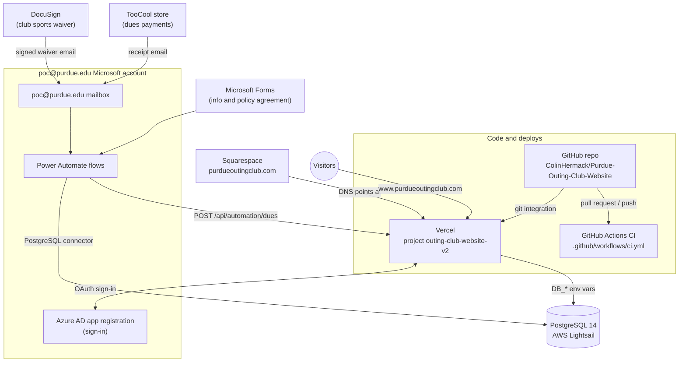

# Outside systems overview

The repository is only part of the website. This page shows every outside system the site depends on, what each one
does, and which account owns it. Each system has its own page with details.

## Systems at a glance

| System | What it does for the site | Owning account | Where its settings live | Details |
| --- | --- | --- | --- | --- |
| GitHub | Source code, pull requests, CI | Personal account `ColinHermack` (see [handoff](../handoff.md)) | Repo settings, `.github/`, `CODEOWNERS` | [Runbooks](../runbooks.md) |
| GitHub Actions | Lint, typecheck, tests, build on every PR | Same as repo | `.github/workflows/ci.yml` | [tests/README.md](../../tests/README.md#continuous-integration) |
| Vercel | Builds and hosts the site, preview deploys, logs, analytics | Team `purdue-outing-clubs-projects`, owner is the club Gmail account | Vercel dashboard | [vercel.md](vercel.md) |
| AWS Lightsail | Hosts the PostgreSQL database | AWS account tied to `poc@purdue.edu` | Lightsail console | [database.md](database.md) |
| Azure AD (Entra ID) | Microsoft sign-in for members | `poc@purdue.edu` | Azure Portal, App registrations | [azure-ad.md](azure-ad.md) |
| Power Automate | Updates dues, waivers, and policy agreements from emails and forms | `poc@purdue.edu` | Power Automate portal | [power-automate.md](power-automate.md) |
| Squarespace | Domain registration and DNS for `purdueoutingclub.com` | TODO(handoff): which account owns the Squarespace domain | Squarespace Domains | [domain-and-links.md](domain-and-links.md) |
| TooCool | Club store where members pay dues; sends receipt emails | TODO(handoff): which officer account manages the TooCool store (organization 1231) | TooCool | [power-automate.md](power-automate.md#dues---toocool) |
| DocuSign | Purdue club sports waiver; sends signed copies | TODO(handoff): confirm (Purdue Rec and Wellness owns the PowerForm?) | PowerForm link in `app/join/page.tsx` | [power-automate.md](power-automate.md#docusign---club-sports-waiver) |
| Microsoft Forms | Info and policy agreement form, trip sign-up forms | `poc@purdue.edu` (TODO(handoff): confirm for trip sign-up forms) | Microsoft Forms | [power-automate.md](power-automate.md) |
| Google Calendar | Embedded club calendar on `/calendar` | Club Gmail account | Google Calendar | [domain-and-links.md](domain-and-links.md#links-and-embeds) |

## Accounts that unlock everything

Two accounts control almost every system above. Whoever maintains the site must have access to both:

- **`poc@purdue.edu`** (Microsoft): Azure AD app registration, Power Automate flows, the mailbox the flows read, and
  the AWS account for Lightsail.
- **The club Gmail account**: owner of the Vercel team, and the Google Calendar.

How to transfer these is in [handoff.md](../handoff.md).
