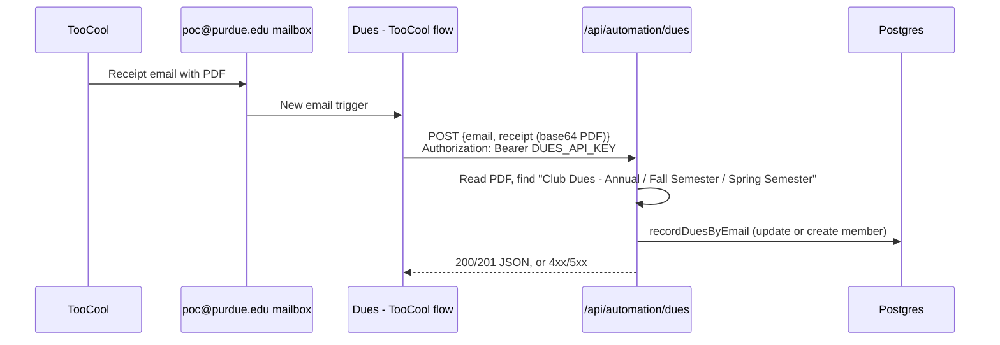

# Power Automate flows

Several [Power Automate](https://make.powerautomate.com) cloud flows keep member records up to date without anyone
typing into the database. **All of them are owned by the `poc@purdue.edu` Microsoft account**, and none of them live
in this repo. Sign in to Power Automate as `poc@purdue.edu` and open **My flows** to see or edit them.

> **Warning:** two of these flows write straight to Postgres through the PostgreSQL connector. If you rename, retype,
> or remove a `member` column they use (`name`, `email`, `policy_agreement`, `waiver_agreement`), the flow starts
> failing and nobody is told unless someone checks its run history. Check [database.md](database.md#who-writes-what)
> before any schema change.

| Flow                                                                    | Trigger                                               | Writes                                     | How it reaches the database                       |
| ----------------------------------------------------------------------- | ----------------------------------------------------- | ------------------------------------------ | ------------------------------------------------- |
| [Dues - TooCool](#dues---toocool)                                       | TooCool receipt email to `poc@purdue.edu`             | `member.dues_data` (and new `member` rows) | HTTP call to the website's `/api/automation/dues` |
| [DocuSign - Club Sports Waiver](#docusign---club-sports-waiver)         | Signed waiver email from DocuSign to `poc@purdue.edu` | `member.waiver_agreement = true`           | PostgreSQL connector                              |
| [Forms - Info and Policy Agreement](#forms---info-and-policy-agreement) | New Microsoft Forms response                          | `member.name`, `member.policy_agreement`   | PostgreSQL connector                              |
| [Trip and roster flows](#trip-and-roster-flows)                         | Not yet documented                                    | `trip`, `trip_roster`                      | Not yet documented                                |

## Dues - TooCool

Members pay dues in the club's TooCool store (the "Pay Dues" button on `/join`). TooCool emails a PDF receipt to
`poc@purdue.edu`, and this flow hands it to the website, which decides what was paid and updates the member.



### Request the flow sends

```http
POST https://www.purdueoutingclub.com/api/automation/dues
Authorization: Bearer <DUES_API_KEY>
Content-Type: application/json

{ "email": "member@purdue.edu", "receipt": "<base64 of the receipt PDF>" }
```

TODO(handoff): confirm which email address the flow sends as `email` (the TooCool customer email on the receipt, or
the sender of the email).

### Responses

| Status | Meaning                                                                                 | What to do                                            |
| ------ | --------------------------------------------------------------------------------------- | ----------------------------------------------------- |
| `200`  | Existing member updated. Body: `{ email, type, expires, created: false }`               | Nothing.                                              |
| `201`  | No member had that email, so one was created, named from the receipt.                   | Check the new member's name looks right.              |
| `400`  | Missing `email`/`receipt`, not a PDF, or unreadable PDF.                                | Look at the failed run's input.                       |
| `401`  | Wrong or missing API key, or `DUES_API_KEY` unset/shorter than 32 characters in Vercel. | Make the flow's key and Vercel's match.               |
| `422`  | The PDF is a TooCool receipt but not for club dues (for example merch).                 | Expected for non-dues purchases.                      |
| `500`  | Database or server error.                                                               | Check Vercel runtime logs for `/api/automation/dues`. |

Rules the website applies (code in `app/api/automation/dues/route.ts` and `utils/duesReceipt.ts`):

- Annual and Spring dues expire on the next Aug 31; Fall dues expire on the next Jan 31.
- A receipt never shortens an existing, later expiration (duplicate or late receipts are harmless).
- If TooCool changes the wording of its line items ("Club Dues - Annual" and so on) or its receipt layout, every
  receipt will come back `422` or get no name. Update the regexes in `utils/duesReceipt.ts` and the tests in
  `tests/unit/utils/duesReceipt.test.ts`.

### Rotating the API key

1. Generate a new key: `openssl rand -base64 48`.
2. Update `DUES_API_KEY` in Vercel (Production and Preview) and redeploy.
3. Update the `Authorization` header in the flow's HTTP action.
4. Resubmit any runs that failed with `401` in between.

### Testing

Run the flow's HTTP action against a preview deployment URL, or call your local dev server with a real receipt PDF:

```bash
curl -k -X POST https://localhost:3000/api/automation/dues \
  -H "Authorization: Bearer $DUES_API_KEY" -H "Content-Type: application/json" \
  -d "{\"email\":\"test@purdue.edu\",\"receipt\":\"$(base64 -i receipt.pdf)\"}"
```

Remember that local and preview deployments write to the **production database**.

TODO(handoff): what the flow does when the website returns an error (retry policy, alert email, nothing).

## DocuSign - Club Sports Waiver

Every member must sign Purdue's club sports waiver through a DocuSign PowerForm (step 3 on `/join`). When a signed
copy is emailed to `poc@purdue.edu`, this flow finds the member and sets `member.waiver_agreement` to `true` using the
Power Automate **PostgreSQL connector**.

- Matching: TODO(handoff): which field the flow matches on (email in the DocuSign envelope?) and what happens when no
  member matches.
- Failure behavior: TODO(handoff).
- In the `all_members` view, a missing waiver shows as `CSW`.

## Forms - Info and Policy Agreement

The info and policy agreement is a Microsoft Form (step 2 on `/join`). Each response updates the member's `name` and
sets `policy_agreement` to `true` through the PostgreSQL connector.

- Insert or update: TODO(handoff): does the flow create a new `member` row when the email is new, or only update
  existing rows? If it inserts, it sets `member_id` itself (see the note in `recordDuesByEmail`).
- Matching: TODO(handoff): confirm it matches on the respondent's Purdue email.
- In the `all_members` view, a missing agreement shows as `IPA`.

## Trip and roster flows

Other flows maintain the `trip` and `trip_roster` tables (trip sign-up forms are linked from each trip page,
`app/trips/[id]/page.tsx`). They are not documented yet. When they are, add a section here using the same headings as
the flows above.

## Checking that flows are healthy

1. Sign in to Power Automate as `poc@purdue.edu`.
2. Open each flow and look at **28-day run history**. Failed runs show the failing step and its input.
3. Check that the PostgreSQL **connection** (Data > Connections) is still authenticated, especially after changing
   `DB_PASSWORD`. A password change breaks the DocuSign and Forms flows until the connection is updated.
