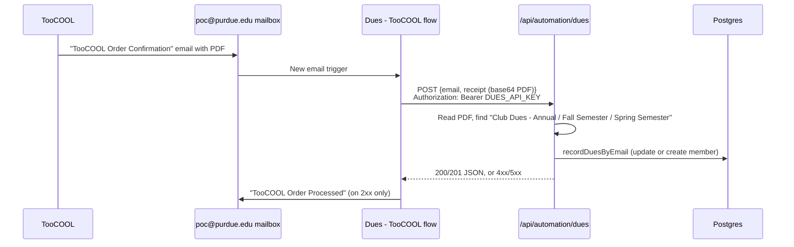

# Power Automate flows

[Power Automate](https://make.powerautomate.com) cloud flows keep member records, trips, and several Google Sheets up
to date without anyone typing into the database. None of them live in this repo. This page was written from an export
of the flow definitions taken in November 2026; if a flow has been edited since, the flow is the truth.

## Where the flows live

- **Account:** sign in as `poc@purdue.edu`. Every flow's connections (Outlook, Forms, PostgreSQL, OneDrive, and so on)
  run as that account.
- **Environment:** pick **Purdue Outing Club** in the environment switcher at the top right. The flows are not in the
  default environment.
- **Solutions:** the flows are grouped into two solutions (left menu > Solutions):
  - **Purdue Outing Club Flows** (`POCflows`): every flow except one.
  - **Shadow Eval v2 (temporary import)** (`ShadowEvalV2`): only _Shadow Evaluation Approval v2_.
- **Backing up:** Solutions > select a solution > Export solution > Unmanaged downloads a zip with every flow's
  definition as JSON. When the version box appears, type the current version number to avoid bumping it. Do this
  before large edits.

> **Warning:** most flows write straight to Postgres through the PostgreSQL connector, using column names and
> `officer.position` titles typed into the flow. Renaming a `member` column, or renaming or leaving empty an officer
> position the flows look up, breaks them without any change to this repo. Check [database.md](database.md#who-writes-what)
> and [Officer positions the flows depend on](#officer-positions-the-flows-depend-on) first.

## All flows

| Flow                                                                                | On  | Trigger                                                 | Writes                                                                     |
| ----------------------------------------------------------------------------------- | --- | ------------------------------------------------------- | -------------------------------------------------------------------------- |
| [Dues - TooCOOL](#dues---toocool)                                                   | Yes | TooCOOL order email in `poc@purdue.edu`                 | `member.dues_data`, new members (through the website)                      |
| [Dues - Manual](#dues---manual)                                                     | Yes | Run by hand                                             | `member.dues_data`, new members                                            |
| [Dues - Waived](#dues-waiver-dues---waived-and-onedrive---waiver-upload)            | Yes | Dues waiver Microsoft Form                              | `member.dues_data`, new members                                            |
| [OneDrive - Waiver Upload](#dues-waiver-dues---waived-and-onedrive---waiver-upload) | Yes | New file in a OneDrive folder (dues waiver form upload) | Nothing (emails the file)                                                  |
| [DocuSign - Club Sports Waiver](#docusign---club-sports-waiver)                     | Yes | DocuSign email in `poc@purdue.edu`                      | `member.waiver_agreement`, new members                                     |
| [Forms - Info and Policy Agreement](#forms---info-and-policy-agreement)             | Yes | Info and policy agreement Microsoft Form                | Most `member` profile columns, new members, an Excel copy of each response |
| [OneDrive - First Aid Upload](#first-aid-and-driver-certification)                  | Yes | New file in a OneDrive folder (first aid upload)        | Nothing (emails the file)                                                  |
| [Forms - First Aid Modify](#first-aid-and-driver-certification)                     | Yes | First aid update Microsoft Form                         | `member.first_aid_data`, new members                                       |
| [OneDrive - First Aid Modify Upload](#first-aid-and-driver-certification)           | Yes | New file in a OneDrive folder (first aid update upload) | Nothing (emails the file)                                                  |
| [Forms - Driver Approvals](#first-aid-and-driver-certification)                     | Yes | Driver approval Microsoft Form                          | `member.driver_data`                                                       |
| [Car Registration](#car-registration)                                               | Yes | Car registration Microsoft Form                         | `member.car_data`                                                          |
| [Forms - Extended Travel Packet](#forms---extended-travel-packet)                   | Yes | Extended Travel Packet Microsoft Form                   | A PDF in OneDrive (nothing in the database)                                |
| [Forms - Trip Leader Training Signup](#forms---trip-leader-training-signup)         | Yes | Trip leader training Microsoft Form                     | Nothing (emails a link)                                                    |
| [Forms - Trip Requests](#trip-and-roster-flows)                                     | Yes | Trip request Microsoft Form                             | New `trip` rows, a Google Calendar event                                   |
| [Trip Requests - Manual](#trip-and-roster-flows)                                    | Yes | HTTP request to the flow's URL                          | New `trip` rows, a Google Calendar event                                   |
| [Forms - Trip Signup](#trip-and-roster-flows)                                       | Yes | Trip sign-up Microsoft Form                             | `member.signup_count`, a row in a Google Sheet                             |
| [Shadow Evaluation Approval v2](#shadow-evaluation-approval-v2)                     | Yes | Shadow evaluation Microsoft Form                        | New `shadow` rows                                                          |
| [Google - All Members](#google-sheet-mirrors)                                       | Yes | Every 72 hours                                          | Rebuilds a Google Sheet from `all_members`                                 |
| [Google - Trip Leaders](#google-sheet-mirrors)                                      | Yes | Daily                                                   | Rebuilds a Google Sheet from `trip_leader_status`                          |
| [Google - Trip Reports](#google-sheet-mirrors)                                      | Yes | Daily                                                   | Rebuilds a Google Sheet from `trip_logs`                                   |
| [Google - Trip Rosters](#google-sheet-mirrors)                                      | Yes | Daily                                                   | Rebuilds a Google Sheet from `rosters`                                     |
| [AI test docusign](#test-and-placeholder-flows)                                     | Yes | DocuSign email in `poc@purdue.edu`                      | Nothing                                                                    |
| [Notes for other flows](#test-and-placeholder-flows)                                | Yes | Run by hand                                             | Nothing                                                                    |
| [Shadow Evaluation Approval](#turned-off-flows)                                     | No  | Shadow evaluation Microsoft Form                        | (replaced by v2)                                                           |
| [Forms - Election Nominations](#turned-off-flows)                                   | No  | Election nomination Microsoft Form                      | An Excel nominations workbook                                              |

## Patterns shared by most flows

Knowing these makes every flow easier to read in the designer.

- **Finding the member.** The flow runs `Get rows` on `member` with the filter `email eq '<address>'` and copies the
  last match's `member_id` into a `Database Query` variable (starting at 0). The address is the form responder's
  Purdue login for Microsoft Forms flows, or text pulled from an email body for the email flows. The comparison is
  exact, so a differently capitalized address is treated as a different person.
- **Creating a member.** When nothing matched (`Database Query` is still 0) and the flow is allowed to create members,
  it reads the highest `member_id`, adds 1, and inserts a row with only `member_id`, `name` and `email`. Two flows doing
  this at the same moment can pick the same id and one insert fails. Because the flows choose ids themselves,
  `member_id_seq` falls behind; the website's `recordDuesByEmail` resyncs it before its own inserts.
- **Five-second delays** inside the `For each` loops ("prevents lag") are there so the PostgreSQL connector finishes
  before the next step reads the variable.
- **Every update also writes `name` and `email`.** The connector's `Update row` needs them, so flows copy the current
  values back. That is harmless but means `name` can change when a form answer differs from what is stored.
- **Officer lookups.** To find who should approve something, the flow reads `officer` rows with a given `position`,
  then the matching `member` row for the email. See
  [Officer positions the flows depend on](#officer-positions-the-flows-depend-on).
- **Approvals** use the _Start and wait for an approval_ action. The approver gets an email and an item in Power
  Automate > Approvals. The run waits (and shows as **Running**) until someone responds, for up to 30 days, then it
  times out and fails.
- **Failure handling.** Most flows wrap their steps in two nested scopes. If the inner scope fails, an email titled
  "Flow Failed - &lt;flow&gt;" goes to `poc@purdue.edu` and the run ends as Failed. Nothing retries; someone has to read
  the email, fix the cause, and resubmit the run from its run history. The exceptions are listed under
  [Known problems](#known-problems).
- **Confirmation emails** to members are sent from `poc@purdue.edu` and say replies are not monitored.

## Membership flows

### Dues - TooCOOL

Members pay dues in the club's TooCOOL store (the "Pay Dues" button on `/join`). TooCOOL emails an order confirmation
with a PDF receipt to `poc@purdue.edu`, and this flow hands the PDF to the website, which decides what was paid and
updates the member.

- **Trigger:** a new email in a specific `poc@purdue.edu` mail folder with the subject "TooCOOL Order Confirmation" and
  an attachment.
- **Steps:** converts the email body to text and takes the text after `Email:` as the member's address (lowercased).
  For each attachment it reads the order number and buyer name from the file name, then POSTs the PDF to the website.
  On success it emails `poc@purdue.edu` "TooCOOL Order Processed" with the order number, name and email.
- **Writes:** nothing directly. The website writes `member.dues_data` and creates the member if needed.
- **Failure handling:** none inside the flow. Any non-2xx response, including `422` for a non-dues purchase, makes the
  HTTP step and the run fail. Expect some Failed runs in its history that are just merchandise orders; open a run to
  see the status code.



#### Request the flow sends

```http
POST https://www.purdueoutingclub.com/api/automation/dues
Authorization: Bearer <DUES_API_KEY>
Content-Type: application/json

{ "email": "member@purdue.edu", "receipt": "<base64 of the receipt PDF>" }
```

The website matches `email` case-insensitively against `member.email`.

#### Responses

| Status | Meaning                                                                                 | What to do                                             |
| ------ | --------------------------------------------------------------------------------------- | ------------------------------------------------------ |
| `200`  | Existing member updated. Body: `{ email, type, expires, created: false }`               | Nothing.                                               |
| `201`  | No member had that email, so one was created, named from the receipt.                   | Check the new member's name looks right.               |
| `400`  | Missing `email`/`receipt`, not a PDF, or unreadable PDF.                                | Look at the failed run's input.                        |
| `401`  | Wrong or missing API key, or `DUES_API_KEY` unset/shorter than 32 characters in Vercel. | Make the flow's key and Vercel's match.                |
| `422`  | The PDF is a TooCOOL receipt but not for club dues (for example merch).                 | Expected for non-dues purchases. The run shows Failed. |
| `500`  | Database or server error.                                                               | Check Vercel runtime logs for `/api/automation/dues`.  |

Rules the website applies (code in `app/api/automation/dues/route.ts` and `utils/duesReceipt.ts`):

- Annual and Spring dues expire on the next Aug 31; Fall dues expire on the next Jan 31.
- A receipt never shortens an existing, later expiration (duplicate or late receipts are harmless).
- If TooCOOL changes the wording of its line items ("Club Dues - Annual" and so on) or its receipt layout, every
  receipt will come back `422` or get no name. Update the regexes in `utils/duesReceipt.ts` and the tests in
  `tests/unit/utils/duesReceipt.test.ts`.
- If TooCOOL changes its email (the `Email:` line in the body) or the attachment file name, the flow sends the wrong
  address or name. Fix the expressions in the flow's _Initialize Email Variable_ and _Set variable Name_ steps.

#### Rotating the API key

1. Generate a new key: `openssl rand -base64 48`.
2. Update `DUES_API_KEY` in Vercel (Production and Preview) and redeploy.
3. Update the `authorization` header in the flow's _HTTP_ action (it holds `Bearer <key>`).
4. Resubmit any runs that failed with `401` in between.

#### Testing

Call your local dev server with a real receipt PDF:

```bash
curl -k -X POST https://localhost:3000/api/automation/dues \
  -H "Authorization: Bearer $DUES_API_KEY" -H "Content-Type: application/json" \
  -d "{\"email\":\"test@purdue.edu\",\"receipt\":\"$(base64 -i receipt.pdf)\"}"
```

Local development writes to the **staging** database; a preview deployment writes to the **production** database.
The flow itself always calls production.

### Dues - Manual

For dues paid some other way (for example cash). An officer runs it from Power Automate (open the flow > Run) and types
the member's **Email** and **Name**.

- Finds the member by email, creating them if missing.
- Sets `dues_data` to `{"Type": "Manual", "Paid": <today>, "Expires": <31 May>}`. The year of the expiration is the
  year 200 days from today, so payments from late summer through early May expire the following 31 May.
- Emails the member a welcome message listing the remaining join steps (agreement form, waiver link).
- Failure email: "Flow Failed - Manual Dues".

### Dues waiver: Dues - Waived and OneDrive - Waiver Upload

Members who cannot pay dues request a waiver through a Microsoft Form that includes a file upload. Two flows handle it:

1. **OneDrive - Waiver Upload** (part 1) runs when the uploaded file lands in its OneDrive folder. It looks up the
   `Treasurer` and `Secretary of Treasury` officers and emails them and `poc@purdue.edu` the file ("Dues Waiver Approval
   Part 1").
2. **Dues - Waived** (part 2) runs on the form response. It looks up the `Treasurer` and `Secretary of Operations`
   officers and starts an approval ("Dues Waiver Approval Part 2") assigned to both and `poc@purdue.edu`; any one of
   them can respond.
   - **Approved:** finds or creates the member, sets `dues_data` to `{"Type": "Waived", ...}` with the same 31 May
     expiration rule as Dues - Manual, and emails the member a welcome message.
   - **Rejected:** emails the member that the waiver was denied and ends as Cancelled.

Both flows start with hard-coded fallback addresses for the two approvers (past officers), which are used only if the
officer lookup finds nobody. Note the second approver's title differs between the two flows (see
[Known problems](#known-problems)).

### DocuSign - Club Sports Waiver

Every member must sign Purdue's club sports waiver through a DocuSign PowerForm (step 3 on `/join`). DocuSign emails
`poc@purdue.edu` when a waiver is completed, and this flow marks the member.

- **Trigger:** a new email in `poc@purdue.edu` whose subject contains "Club Sports Waiver".
- **Steps:** pulls `Email:`, `Name:` and `Document:` values out of the email body. If the document is not the Club
  Sports Waiver, it stops quietly. If the email is not a `purdue.edu` address, it emails the signer (at a guessed
  `@purdue.edu` address when the typed one looks like a misspelled Purdue address) asking them to sign again with
  their Purdue email, and ends as Cancelled. Otherwise it finds or creates the member, sets
  `waiver_agreement = true`, and emails a confirmation listing the remaining join steps.
- **Failure email:** "Flow Failed - DocuSign Waiver".
- The PowerForm belongs to the club's faculty advisor (Jillian Carr as of November 2026), because only faculty and IT
  staff can create PowerForms. If the waiver link on `/join` needs to change, ask the advisor. The same link is also
  typed into the confirmation emails of Dues - Manual, Dues - Waived and the info and policy agreement flow.
- In the `all_members` view, a missing waiver shows as `CSW`.

### Forms - Info and Policy Agreement

The info and policy agreement is a Microsoft Form (step 2 on `/join`) that members fill in while signed in with their
Purdue account. This is the largest flow.

1. **Name:** uses the preferred name if given (preferred first name plus legal last name), otherwise the legal name.
2. **Find or create** the member by the responder's login email.
3. **Excel copy:** appends the whole response to an Excel table in the `poc@purdue.edu` OneDrive.
4. **Confirmation email** to the member listing the remaining join steps.
5. **General update:** `name`, `pronouns`, `phone`, `emergency_data`, `school_year`, `campus`, and
   `policy_agreement = true`.
6. Then, in parallel:
   - **Signature check:** the form asks the member to type their name under three policies (Safety, Behavior, Gear
     Closet). If any differs from the legal name, `policy_agreement` goes back to `false` and the
     `Secretary of Operations` gets an approval; approving sets it to `true` again.
   - **First aid:** if they answered "I have an active certification", writes `first_aid_data` with
     `"Verified": false`, then asks the Health & Safety officer and `poc@purdue.edu` to approve. Approving rewrites it
     with `"Verified": true`. The uploaded certificate reaches the approver through
     [OneDrive - First Aid Upload](#first-aid-and-driver-certification).
   - **Driver:** if they answered "I have an approved RM-01 from another organization", writes `driver_data` with
     `"Expires": "1900-01-01", "Verified": false`, then asks the `Data Analyst` and `poc@purdue.edu` to check Purdue
     Risk Management's approved driver list. The approver must type the expiration date as `YYYY-MM-DD` in the
     approval comments; approving writes that date with `"Verified": true`.
   - **Car:** if they have a car on campus, writes `car_data`.
   - **Medical:** if any of allergies, conditions or medications is filled in (and not "N/A"), writes `medical_data`.
7. **Failure email:** "Flow Failed - Info Policy Forms".

In the `all_members` view, a missing agreement shows as `IPA`.

### First aid and driver certification

**First aid.** A first aid certificate arrives two ways, each split into a file flow and a form flow so the approver
sees the document:

| Situation                       | File flow (emails the uploaded certificate)                          | Form flow (writes the data)                                |
| ------------------------------- | -------------------------------------------------------------------- | ---------------------------------------------------------- |
| New member with a certification | OneDrive - First Aid Upload ("First Aid Verification Part 1")        | Forms - Info and Policy Agreement (above)                  |
| Existing member renewing        | OneDrive - First Aid Modify Upload ("First Aid Verification Part 1") | Forms - First Aid Modify ("First Aid Verification Part 2") |

- The file flows run when a file appears in their OneDrive folder (where the form stores uploads). They look up the
  `Health & Safety Officer` and email them and `poc@purdue.edu` the file.
- **Forms - First Aid Modify** finds or creates the member, writes `first_aid_data` with `"Verified": false`, and
  starts an approval for the `Health & Safety Officer` and `poc@purdue.edu`. On approval it emails the member and
  rewrites `first_aid_data` with `"Verified": true`. Failure email: "Flow Failed - First Aid Modify".
- Writing `first_aid_data` fires the `update_certified_trigger` database trigger, which copies `Verified` into
  `trip_leader.process.certified`. So a resubmission briefly un-certifies a trip leader until it is approved.

**Driver certification.** Besides the RM-01 path in the info and policy agreement, **Forms - Driver Approvals**
handles the driver form linked from `/drivers` (members who enrolled through Purdue's SambaSafety process): it asks the
`Data Analyst` to check Risk Management's database. On approval it finds the member (it does not create one; non-members get an email telling them to join
first) and writes `driver_data`, then emails a confirmation. On rejection it emails the member. See
[Known problems](#known-problems) for the date it writes.

The `driver_set_verified_false` trigger marks `driver_data` unverified once `Expires` passes.

### Car Registration

A separate Microsoft Form lets members register or change a car. The flow finds the member by the email answered in
the form and writes `car_data` (`Model`, `Color`, `Capacity`, `Hitch`, `Nickname`). It does not create members. See
[Known problems](#known-problems): its failure handling is wired backwards.

### Forms - Extended Travel Packet

Builds a member's prefilled Extended Travel Packet (ETP) for a trip.

- Stops (Cancelled) if the member answers "No" to either eligibility question.
- Finds the member; non-members get an "Invalid Membership" email. It does not create members.
- Fills a Word template in the `poc@purdue.edu` OneDrive with the member's name, emergency contact
  (`emergency_data`), and the form answers, saves it in the OneDrive folder `/Extended Travel Packets` as
  `temporaryETP.docx`, converts it to PDF, saves the PDF there as `<purdue username>.pdf`, and emails the PDF to the
  member to sign and send to their trip leader.
- If the member's row has no usable `emergency_data` the lookup step fails and the member is told to complete the
  info and policy agreement first.
- Failure email: "Flow Failed - ETP Forms".

### Forms - Trip Leader Training Signup

Checks that the responder is a member. Members get an email with the trip leader Google Classroom link; non-members get
an email pointing to `/join`. Writes nothing.

## Trip and roster flows

### Forms - Trip Requests

Trip leaders propose a trip through a Microsoft Form.

1. Looks up the `Data Analyst` in the `pofficers` view and sends them an approval with the trip details.
2. **Approved:** inserts a `trip` row. The new `trip_id` is the current highest plus 1. It sets `name`, `startdate`,
   `enddate` (Eastern time from the form), `sport`, `location`, `description`, `difficulty` (Beginner 1, Intermediate
   2, Advanced 3, Expert 4), an empty `logs` template, and **`signup = false`**. It then creates an event in the club
   Google Calendar (`purdueouting@gmail.com`) whose description links to `https://purdueoutingclub.com/trips/<id>`, and
   emails the leaders and shadows listed on the form.
3. **Rejected:** emails the leaders and shadows with the approver's comments.

Because new trips start with `signup = false`, they do not appear on `/trips` until someone sets `signup` to `true` in
the database. No flow does that.

### Trip Requests - Manual

The same steps as Forms - Trip Requests, but triggered by an HTTP request to the flow's URL with the trip as JSON
(`Email`, `Leaders`, `Event_Name`, `Start_Date`, `Start_Time`, `End_Date`, `End_Time`, `Sport`, `Location`,
`Description`, `Difficulty`, and sign-up open/close fields). The approval goes to one hard-coded person rather than an
officer lookup. Nothing in this repo calls it. Its trigger is set so that anyone with the URL can run it, so treat the
URL as a secret.

### Forms - Trip Signup

Members sign up for a trip with a Microsoft Form (linked from each trip page, prefilled with the trip id; see
`app/trips/[id]/page.tsx`).

1. Finds the member and the trip by the trip id answered on the form.
2. Checks the member is active: `holds` is null, `policy_agreement` and `waiver_agreement` are true, and
   `dues_data.Expires` is in the future. If not, it emails the member which of those is missing and stops; their
   information is **not** passed to the trip leader.
3. Reads the member's first aid, car, driver and medical details (treating missing or expired ones as blank) and their
   trip leader `lead_count`.
4. Appends a row to the trip sign-up **Google Sheet** with the member's name, contact details, year (prefixed "INDY"
   for the Indianapolis campus), gear needed, experience, previous trips, car, first aid, driver and medical notes.
5. Adds 1 to `member.signup_count` and emails the member that their request reached the trip leader.

This flow does **not** write `trip_roster`. Trip leaders pick their roster from the sheet; how rosters get into
`trip_roster` is not handled by any flow.

### Google sheet mirrors

Four scheduled flows copy a database view into a Google Sheet (in the Google account behind the flows' Google Sheets connection) so officers can read
it without database access. Each run deletes every row in the sheet (up to several passes), writes a "Currently
refreshing" or "Do not manually edit" marker row, inserts one row per view row, then removes the marker. **Edits made
in these sheets are lost on the next run.**

| Flow                  | Schedule (US Eastern) | Source view          | Columns                                                                                       |
| --------------------- | --------------------- | -------------------- | --------------------------------------------------------------------------------------------- |
| Google - All Members  | Every 72 hours        | `all_members`        | Name, Active, Email, Phone, First Aid, Driver, Car, Medical, Emergency Email, Emergency Phone |
| Google - Trip Leaders | Daily                 | `trip_leader_status` | Name, Pronouns, Sport, Trips Led, Status                                                      |
| Google - Trip Reports | Daily                 | `trip_logs`          | Sport, Category, Name, Trip Dates, Location, Summary, Photo Link                              |
| Google - Trip Rosters | Daily                 | `rosters`            | Trip, Names                                                                                   |

Google - All Members skips members whose status is `No Dues IPA CSW` (missing everything) and reads the view in
alphabetical batches (A-F, G-L, M-R, S-Z) to stay under connector limits. Its sheet contains medical and emergency
contact information, so keep its sharing list short. Renaming a view or one of these columns breaks the matching
flow.

## Shadow Evaluation Approval v2

After a trip, the leader fills in a shadow evaluation form about a shadow (a trip leader in training). This flow is in
its own solution, `ShadowEvalV2`.

1. Validates the response: the trip id must exist in `trip` and have a `sport`; the evaluator and the shadow must both
   be members, the evaluator must have a `trip_leader` row and must not be the shadow; the form must have a Yes/No
   recommendation; and every approver below must be found. Problems are emailed back to the evaluator (copying
   `poc@purdue.edu`) and the run ends as Cancelled.
2. If the leader does **not** recommend the shadow, inserts a `shadow` row with every approval `false` and emails the
   shadow.
3. Otherwise starts one approval that **all** of these must answer: the head officer for the trip's sport
   (`Head <Sport> Officer`, or `Chief Angler` for fishing; skipped for hiking), the `Secretary of Sports`, and the
   `Health & Safety Officer`, found in the `pofficers` view.
4. Inserts a `shadow` row (`member_id`, `trip_id`, `eval_data` JSON of the form answers, `leader_approved`,
   `head_approved`, `sec_approved`, `safety_approved`) and emails the shadow either congratulations or the reviewers'
   comments.
5. Failure email: "Flow Failed - Shadow Evaluation Approval", including the shadow, trip and evaluator. If the approval
   waits more than 30 days it times out and this email is sent.

It does not change `trip_leader.process.shadow`; that is still updated on `/tripleadersdashboard`. The `shadow` table
is newer than `tests/integration/schema.sql`, so it is not in the repo's schema dump yet.

## Test and placeholder flows

- **AI test docusign:** an experiment that runs AI Builder text extraction on DocuSign waiver emails. It writes nothing
  but is turned on, so it runs (and uses AI Builder credits) on every waiver email. It can be turned off.
- **Notes for other flows:** a manual flow with a single delay step. It exists to hold notes in its description.

## Turned-off flows

- **Shadow Evaluation Approval:** the first version of the shadow evaluation flow, replaced by v2. Kept for reference.
- **Forms - Election Nominations:** used during officer elections. It records each nomination in an Excel workbook in
  the `poc@purdue.edu` OneDrive, asks the nominee to accept through an approval, and emails election organizers (two
  addresses typed into the flow). Update those addresses before turning it on for the next election.

## Officer positions the flows depend on

The flows find approvers by exact `officer.position` text. If a title is renamed, or nobody holds it after officer
turnover, the matching approvals go only to `poc@purdue.edu` or to nobody.

| `officer.position`                     | Used by                                                                                     |
| -------------------------------------- | ------------------------------------------------------------------------------------------- |
| `Treasurer`                            | Dues - Waived, OneDrive - Waiver Upload                                                     |
| `Secretary of Treasury`                | OneDrive - Waiver Upload                                                                    |
| `Secretary of Operations`              | Dues - Waived, Forms - Info and Policy Agreement (signature check)                          |
| `Data Analyst`                         | Forms - Info and Policy Agreement (driver), Forms - Driver Approvals, Forms - Trip Requests |
| `Health & Safety Officer`              | Forms - First Aid Modify, both first aid upload flows, Shadow Evaluation Approval v2        |
| `Health & Safety`                      | Forms - Info and Policy Agreement (first aid); see [Known problems](#known-problems)        |
| `Secretary of Sports`                  | Shadow Evaluation Approval v2                                                               |
| `Head <Sport> Officer`, `Chief Angler` | Shadow Evaluation Approval v2 (sport taken from `trip.sport`)                               |

## Known problems

Found while reading the flow definitions in November 2026. None of these are caused by the website.

- **Failure emails wired backwards.** In _Car Registration_, _Forms - Driver Approvals_, _Forms - Trip Leader Training
  Signup_, _Forms - Trip Requests_ and _Trip Requests - Manual_, the "Flow Failed" email runs only when the steps
  **succeed** (its run-after setting is "is successful" instead of "has failed"). Normally a Terminate step ends the
  run first, so no email is sent either way, and real failures send no email. To fix, open the email action > the
  `...` menu > Settings > Run after, and select only "has failed".
- **Car Registration always ends as Failed.** Its last step, _Terminate - Succeeded_, is set to status Failed. Check
  `member.car_data` rather than the run status. Its member lookup filter also lacks quotes around the email
  (`email eq <address>` instead of `email eq '<address>'`), which may make the lookup itself fail.
- **Forms - Driver Approvals writes a fixed date.** On approval it writes
  `{"State": "Samba", "License": "Samba", "Expires": "2027-07-27", "Verified": true}` for every member, ignoring the
  date the approver types. Update the date (or make it read the approval comment) before 27 July 2027, or every
  certification it granted expires at once. Its failure email text also says "Waiver Dues Flow".
- **Health & Safety title mismatch.** The info and policy agreement flow looks up `Health & Safety`, while the other
  first aid flows look up `Health & Safety Officer`. Whichever title the `officer` table does not use, that flow's
  first aid approvals go only to `poc@purdue.edu`.
- **Second dues waiver approver differs.** OneDrive - Waiver Upload emails the `Secretary of Treasury`, but Dues -
  Waived asks the `Secretary of Operations` to approve, so the person approving may not have received the file.
- **Approvals pile up.** Runs waiting on an approval show as Running. In November 2026 Forms - Driver Approvals had
  about ten runs waiting up to 16 days. After 30 days they time out and the member is never updated.
- **Duplicate member ids** are possible when two flows create members at the same moment (see
  [Patterns](#patterns-shared-by-most-flows)).

## Checking that flows are healthy

1. Sign in to Power Automate as `poc@purdue.edu` and select the **Purdue Outing Club** environment.
2. Open each flow's details page and read **28-day run history**. Failed runs show the failing step and its input;
   _Resubmit_ reruns them after a fix. A flow with a red "Flow checker" banner has a step that will not run.
3. Open **Approvals** and look for requests waiting on an officer who has left.
4. Check that the **connections** (Data > Connections) are still signed in: Office 365 Outlook, Microsoft Forms,
   PostgreSQL, Approvals, OneDrive for Business, Excel Online, Word Online, Google Sheets, and Google Calendar. A
   `DB_PASSWORD` change breaks every PostgreSQL-based flow until the PostgreSQL connection is updated.
5. After officer turnover, confirm every title in
   [Officer positions the flows depend on](#officer-positions-the-flows-depend-on) has a current officer.
