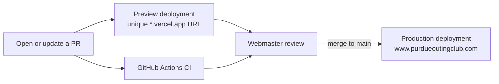

# Vercel

[Vercel](https://vercel.com) builds and hosts the site. It is connected to the GitHub repo, so you never deploy by
hand: opening a pull request makes a preview, and merging to `main` updates production.

## Where to find it

| Thing             | Value                                                                                                |
| ----------------- | ---------------------------------------------------------------------------------------------------- |
| Team              | `purdue-outing-clubs-projects`                                                                       |
| Team owner        | "Purdue Outing Club" Vercel user, signed in with the club Gmail account. It is the only team member. |
| Project           | `outing-club-website-v2`                                                                             |
| Framework preset  | Next.js, Node.js 22.x                                                                                |
| Production domain | `www.purdueoutingclub.com`                                                                           |
| Apex domain       | `purdueoutingclub.com` permanently redirects (308) to `www`                                          |
| Vercel URL        | `outing-club-website-v2.vercel.app`                                                                  |

The domain itself is registered at Squarespace; see [domain-and-links.md](domain-and-links.md).

## How deploys work

- **Preview deployments**: every push to a PR branch builds a preview. Vercel posts the link on the PR. Previews use
  the _Preview_ environment variables, which point at the **production database** (there is no separate staging
  database), so anything you do on a preview, such as editing a trip leader, changes real data.
- **Vercel Authentication** is on for all previews and for the production `*.vercel.app` deployment URLs. Only
  members of the Vercel team can open them. The custom domain `www.purdueoutingclub.com` is public.
- **Production deployment**: merging to `main` builds and promotes automatically.
- The build runs `next build`, which queries the database for a few pages (see
  [architecture.md](../architecture.md#rendering-and-the-build)). If the database is unreachable, the build fails.
- Signing in on a preview: `NEXTAUTH_URL` is the same value for every environment, so the Microsoft login returns you
  to that URL rather than to the preview. TODO(handoff): confirm whether sign-in is expected to work on previews.

## Environment variables

Set in **Project > Settings > Environment Variables**. Local development reads the same keys from `.env` at the repo
root. Values are never committed; get them from the current webmaster.

| Key                                            | Environments                    | Purpose                                                    | Where the value comes from                                                     | Rotate when                                                                                              |
| ---------------------------------------------- | ------------------------------- | ---------------------------------------------------------- | ------------------------------------------------------------------------------ | -------------------------------------------------------------------------------------------------------- |
| `DB_HOST`, `DB_PORT`, `DB_DATABASE`, `DB_USER` | All                             | Postgres connection used by every miniservice              | AWS Lightsail database page                                                    | Database moves                                                                                           |
| `DB_PASSWORD`                                  | All                             | Postgres password                                          | AWS Lightsail database page                                                    | Someone with access leaves                                                                               |
| `AZURE_AD_CLIENT_ID`                           | All                             | Identifies the Microsoft sign-in app                       | Azure Portal app registration                                                  | App re-created                                                                                           |
| `AZURE_AD_TENANT_ID`                           | All                             | Purdue's Microsoft tenant                                  | Azure Portal app registration                                                  | Never                                                                                                    |
| `AZURE_AD_CLIENT_SECRET`                       | All (Sensitive)                 | Proves the site is the sign-in app                         | Azure Portal, Certificates and secrets                                         | **Before it expires** ([azure-ad.md](azure-ad.md#rotating-the-client-secret))                            |
| `NEXTAUTH_URL`                                 | All                             | Public URL of the site, used for sign-in callbacks         | `https://www.purdueoutingclub.com` in Vercel, `https://localhost:3000` locally | Domain changes                                                                                           |
| `NEXTAUTH_SECRET`                              | All                             | Signs the session cookies                                  | `openssl rand -base64 32`                                                      | Suspected leak (signs everyone out)                                                                      |
| `DUES_API_KEY`                                 | Production, Preview (Sensitive) | Bearer token the Dues flow sends to `/api/automation/dues` | `openssl rand -base64 48`                                                      | Suspected leak; update the flow at the same time ([power-automate.md](power-automate.md#dues---toocool)) |

After changing a variable, **redeploy** (Deployments > latest production > Redeploy). Running deployments keep the
old value.

`NEXTAUTH_SECRET` and `DB_PASSWORD` are currently stored as normal encrypted variables, so anyone on the team can
read them in the dashboard. Consider re-creating them as **Sensitive** variables (see [handoff.md](../handoff.md)).

## Logs, errors and rollbacks

- **Build logs**: Deployments > pick a deployment > Build Logs. Start here when a deploy fails.
- **Runtime logs**: Project > Logs. Filter by route (for example `/api/automation/dues`) and status code. Route
  handlers catch errors and return `500` without logging details, so a 500 with no stack trace usually means a
  database or input problem inside the miniservice.
- **Roll back**: Deployments > pick the last good production deployment > **Instant Rollback**. This is the fastest
  fix for a bad merge. Then revert the bad commit on `main` so the next deploy does not bring it back.
- **Analytics and Speed Insights**: enabled through `<Analytics />` and `<SpeedInsights />` in `app/layout.tsx`.
  View them under the project's Analytics and Speed Insights tabs.

## Health check

`GET /api/healthcheck` returns `200 API is online.` without touching the database. Use it to tell "the site is down"
apart from "the database is down".
